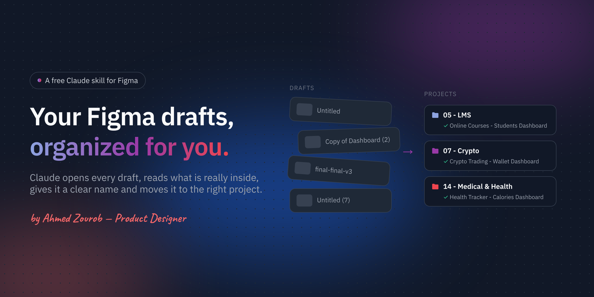
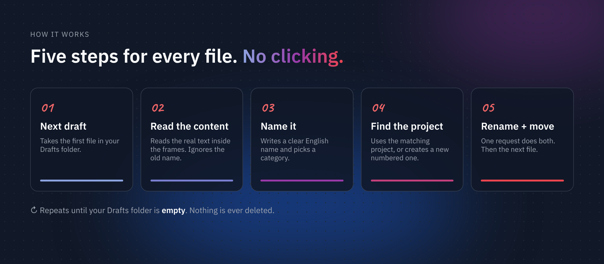

<p align="center">
  
</p>

<p align="center">
  <a href="#install"><b>Install</b></a> ·
  <a href="#how-to-use"><b>How to use</b></a> ·
  <a href="#how-it-works"><b>How it works</b></a> ·
  <a href="#before-you-run-it"><b>Before you run it</b></a>
</p>

## The problem

Every designer has a Drafts folder like this.

`Untitled`. `Untitled (7)`. `Copy of Dashboard (2)`. `final-final-v3`.

Hundreds of files. Most names say nothing about what is inside.

Cleaning it by hand means opening each file, looking at it, renaming it, and dragging it to a project. One by one.

Nobody does that. So the folder keeps growing.

## What is Figma Drafts Organizer?

It is a **Claude skill** that cleans your Figma Drafts folder for you.

For every draft, Claude:

- opens the file and reads the real text inside its frames
- decides what the design actually is
- gives it a clear English name
- moves it to the matching numbered project, or creates one

Then it moves on to the next file. It keeps going until your Drafts folder is empty.

**The core rule:** the file's content is the truth. The old name is ignored.

## How it works

<p align="center">
  
</p>

The skill works through Claude in Chrome, inside your own signed-in Figma tab.

There is no mouse automation. No dragging cards. No Move dialog.

Renaming and moving happen in **one request**. That is why it is fast and does not get stuck.

## A practical example

A draft called `Untitled (4)`.

Claude reads the frames and finds: *Courses, Students, Lecturer, Progress, Analytics*.

The result:

```text
Name:    Online Courses - Students & Performance Dashboard
Project: 05 - LMS Dashboard
```

A few more from real runs:

| Content Claude found | New name | Project |
| --- | --- | --- |
| Wallet, exchange, charts | Crypto Trading Platform - Wallet & Exchange Dashboard | 07 - Crypto |
| Messages, groups, contacts | Chat App - Messages & Groups Dashboard | 36 - Chat & Messaging |
| Calories, workouts, goals | Health Tracker - Calories & Training Dashboard | 14 - Medical & Health |

If no project fits, Claude creates the next numbered one, like `49 - Crowdfunding & Fundraising Dashboard`.

## Who is it for?

- **UI designers** with a Drafts folder full of dashboard shots and templates
- **Design teams** that want one clean naming pattern across every file
- **Anyone** who bought UI kits and lost track of what is where

## Install

**Claude app (web, desktop)**

1. Download [`figma-drafts-organizer.zip`](figma-drafts-organizer.zip) from this repository.
2. In Claude, open **Settings → Capabilities** and make sure code execution and file creation is on.
3. In the Skills section, click **Upload skill**, choose the ZIP and turn the skill on.

**Claude Code**

```bash
git clone https://github.com/ahmeduxui/figma-drafts-organizer.git
cp -r figma-drafts-organizer/figma-drafts-organizer ~/.claude/skills/
```

You also need **Claude in Chrome**, with Chrome signed in to your Figma account.

## How to use

1. Open your team's Drafts page in Chrome:
   `https://www.figma.com/files/team/{TEAM_ID}/drafts`
2. Ask Claude:

```text
/figma-drafts-organizer Organize my Figma drafts.
```

Claude will ask for two things the first time:

- **Your team ID** — the number after `/team/` in the Drafts page URL.
- **A Figma personal access token** — Figma → Settings → Security → Personal access tokens. Choose **File content: Read only**. It is used only to read what is inside each file.

Then it runs on its own and reports one line per file.

Want to check the names first? Ask for a preview:

```text
/figma-drafts-organizer Show me a preview table first. Don't move anything yet.
```

## Before you run it

**It never deletes anything.** Files only get renamed and moved.

**It never changes sharing or permissions.** New projects are created without adding anyone.

**It uses Figma's internal web API.** These are the same requests the Figma web app makes, but they are not documented. Figma can change them at any time, and the skill may stop working until it is updated. Use it at your own discretion and in line with Figma's terms.

**Keep your token private.** Don't paste it into a file you share or commit.

**Try it on a small team first.** Run a preview, check the names, then let it run.

## What's inside

```text
figma-drafts-organizer/
├── SKILL.md                  The five steps, rules and setup
├── references/
│   └── categories.md         A starter list of numbered categories
└── scripts/
    ├── helpers.js            Browser helpers: read drafts, inspect, rename + move
    └── deep_walk.js          Deeper read for files with little text
```

---

## Author

**Ahmed Zourob** — Product Designer.

Also by me: [DesignXI](https://github.com/ahmeduxui/DesignXI), a Claude skill that runs the full UX/UI design process in 27 phases.

## License

[MIT](LICENSE) © 2026 Ahmed Zourob.

Figma is a trademark of Figma, Inc. This project is not affiliated with or endorsed by Figma.
